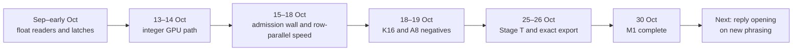

<!-- freshness: sources=CHARTER.md,archive/catalog.jsonl checked=a70d6189df3368575e745d351ed692cb000e9388 -->
# Research line: discrete attention for the language base (M1)

This line asked whether a model using integers and small geometric moves could learn to read earlier
text well enough to predict the next word. **At M1's registered bars, the answer is yes.** A saved
discrete model beats unigram and T2 at two seeds through its integer export. That does not establish
useful conversation or the independent effect of every mechanism.

| | |
|---|---|
| **Catalog id** | `m1-discrete-attention` |
| **Time span** | 7 Aug to 30 Oct 2026 |
| **Milestone** | M1, the language base |
| **Records** | 199 in the 19 Oct audit, plus the later M1 and generation records linked below |
| **State** | **Complete at M1 scope; M2 and new-phrasing generation are next** |

Counts through 19 Oct: `archive/catalog.jsonl`. Terms follow the [glossary](../../start/glossary.md);
ACTIVE, READY and PARKED are defined on the [mechanism board](../../mechanisms/README.md).

*M1 is a saved-model result. The next question is complete generation, not another repetition of the count-table test.*

## What it set out to do

Give the discrete model an attention-like read of context. Under the rules (no softmax, no dense
matmul, integer serving), the read could be a tree walk (Route), a small neighbour set rotated into
the query's frame (Flock), or a link-following rule (Relation). The yardstick became six bars on one
saved model: self-contained D11, exact 14,287-row DEV export and B4, tokens/s, DEV above both count tables, Fresh V2
transfer, and held-out-phrasing transfer ([CHARTER §4.8](../../../CHARTER.md#4-evidence)).

## What happened, in order

1. **Float readers and latches (19 Sep–5 Oct).** A hard capture-and-hold gate answered 128/128
   original and stress rows, against 47–59 for controls. Fresh complete replies stayed low.
2. **First integer GPU path (13–14 Oct).** Eleven then 25 construction controls passed. The first
   pilot raised top-1 from 17 to 82 and top-8 from 173 to 1,169, while total loss rose. The starting
   table had only 16 distinct vectors for 4,096 tokens.
3. **The admission wall (15–17 Oct).** Re-scored checkpoints never reached the 4,894 admission bar.
   A context-free successor table already scored 6,300 of 14,287.
4. **Row-parallel speed (16–18 Oct).** A row-parallel proposal matched exact losses and was about 56
   times faster in a non-gating diagnostic.
5. **Paired tests and K16 (18–19 Oct).** K16-A scored 65 and 463. K16-R collapsed to 19 or 20 cells.
   No run was kept, and the fresh slice stayed sealed.
6. **A8 address cells (19 Oct).** Predecessor-structured placement lifted starting admission from
   127 to 1,351 of 3,847, then training eroded it. Relation stopped at 551; the frozen control held 857.
7. **Stage T exports (25–26 Oct), then the 19-table M1 trunk (30 Oct).** Stage T's four-table exports came first. The later joint-pointer Hamilton trunk produced the two seeded M1 `UORLUT01` artifacts with exact 14,287-row DEV export agreement. DEV scored 7,002 and 7,001; Fresh V2 scored 7,215 and 7,228, at both seeds above both controls ([M1 close](../../labs/m1-close-saved-model/README.md), [Fresh V2](../../labs/m1-fresh-panel-transfer/README.md)).
8. **Held-out phrasing (30 Oct).** p-f has no prompt value-masked templates in TRAIN at K = 1,024.
   The saved model scored 7,850 and 7,872 of 15,953 against T2's 7,375, beyond paired band 81.
   Its separate DEV export agreement was exact on 14,287 rows; Apple M1 decode is 10,876 and
   10,566 tok/s. M1 closed at all six bars.
9. **The next failure (30 Oct).** On the separate FBS generation path, claude-217's cycle step ends
   every registered loop but content is underpowered. On p-s, teacher-forced reply openings are 17.4%, 13.7% and
   18.6% at three seeds, against about 80% on later tokens. Exact-key memory misses reworded prompts.

## Key results

| Result | Kind | Source |
|---|---|---|
| Saved M1 model: DEV 7,002 / 7,001 of 14,287 against unigram 1,226 and T2 6,300 | measurement | [M1 close](../../labs/m1-close-saved-model/README.md) |
| Fresh V2: 7,215 / 7,228 of 14,479 against unigram 1,279 and T2 6,582 | measurement | [Fresh transfer](../../labs/m1-fresh-panel-transfer/README.md) |
| p-f: 7,850 / 7,872 of 15,953 against unigram 1,409 and T2 7,375, band 81; 62.5% of reference replies are verbatim TRAIN replies (reference overlap, not a generated-copy rate) | measurement | [bar-f report](../../loop/tasks/m1-heldout-phrasing-transfer/claude-211/REPORT.md) |
| Apple M1 decode 10,876 / 10,566 tok/s | measurement | [bar-f report](../../loop/tasks/m1-heldout-phrasing-transfer/claude-211/REPORT.md) |
| K16-A: 65 and 463 below unigram 1,226 and T2 6,300 | dated configuration negative | [K16 outcome](../../labs/k16-outcome-call-2026-10-19/README.md) |
| A8 address cells: 127 to 1,351 of 3,847 at zero training, then erosion | measurement | [pre-flight](../../labs/address-cells-preflight-2026-10-19/README.md), [A8 dose](../../labs/a8-dose-2026-10-19/README.md) |
| Teacher-forced p-s reply openings 17.4%, 13.7%, 18.6% against about 80% on later tokens | measurement | [claude-217](../../loop/tasks/one-model-end-to-end/claude-217/REPORT.md) |

## What it taught

Check the instrument first: register mismatches, JSON keys and hash domains can block a valid run
without testing a mechanism. Development is not fresh, and a pass is not a language result. A fresh
panel can hold new values without new phrasings; p-f adds new phrasings but still shares 62.5% of its
reference replies with TRAIN. The saved-model result is meaningful because it uses the integer
artifact, two seeds and paired controls—not because the geometry looks elegant.

## Current state

M1 is complete at its declared scope. The next questions are M2/M3: complete correct replies,
durable memory and a joined served model. On new phrasing, the immediate blocker is reply opening
and an exact memory key that reworded known questions can reach. The M1 discrete model and the FBS
trunk remain separate.

**Go deeper:** the [generated catalog page](../../../archive/catalog/m1-discrete-attention.md) lists
all 199 records in the 19 Oct audit; the M1 close and claude-217 are linked above.
