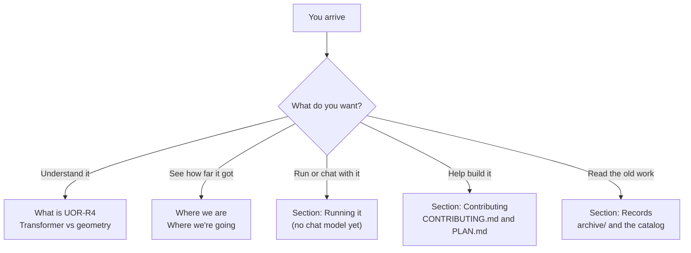

<!-- freshness: sources=CHARTER.md,PLAN.md,docs/research/notebook/README.md checked=d5eb4a55656726b04ea79b06968f91905933c925 -->
# Frequently asked questions

**In one paragraph.** These are the questions newcomers and would-be contributors ask most often, answered plainly. The short version: UOR-R4 is a pre-alpha research project that tries to build a fast language model out of geometry instead of a transformer's expensive arithmetic. **M1 is complete: the saved discrete model beats both count tables at two seeds through its integer export.** No model holds a useful conversation yet ([PLAN](../../PLAN.md)). Words in the answers are defined in the [glossary](./glossary.md).

*Which section of this page to read first.*

Claims are labelled **proof** (follows from definitions or code), **measurement** (from a recorded run) or **hypothesis** (untested), as in [`docs/formal_vocabulary.md`](../formal_vocabulary.md). `NOT_RUN` means a test was planned and never executed. It is not a pass.

## The basics

### 1. What is UOR-R4, in plain words?

It is an open research project that asks one question: can a language model run on an ordinary laptop or in a browser if its core arithmetic is geometry (rotations, exact whole-number addresses built from primes, lookup tables) instead of the huge decimal multiplications inside today's chat AIs? The project is pre-alpha and the answer is not known yet. See [what UOR-R4 is](./what-is-uor-r4.md) and the [charter](../../CHARTER.md), section 1.

### 2. Is this a transformer?

No, by design. The charter says the project is "not a transformer" (section 1), bans matrix multiplication (section 3.3) and excludes "a dense model disguised as lookup tables" from serving (section 3.6) ([charter](../../CHARTER.md)). The saved discrete M1 model uses a Flock read and an orbit-root causal pointer plus a discrete Hamilton gate; Route and Relation are other discrete mechanisms, not isolated by M1's whole-model pass. The separate FBS trunk uses a Hamilton-gated recurrence and SpiralCore/FBS routes; the dated float projection form remains READY. Older float models (7 million to 214 million parameters) used softmax, matrix multiplication and a SiLU activation, so they did not follow today's rules (**measurement**, [geometric stack](../mechanisms/geometric-stack.md)). The comparison page is [transformer vs geometry](./transformer-vs-geometry.md).

### 3. Does it work yet?

M1's narrow next-token test passes; no useful conversation is established. The saved discrete model beats both count tables at both seeds through its integer export, with exact 14,287-row DEV export/reference agreement and tokens per second reported. The integer serving engine, the object-store consumer's frozen host-control panel, the separate true-address exact-read oracle, the Studio worker and desktop shell also work at their declared scopes. The host-control panel is not M3 qualification. A passing construction control alone is not a language result; M1 is a panel result, not useful chat ([open questions](../research/open-questions.md)).

The separate float-trained FBS `lut-stack/5` trunk is also exported with exact rotations and its DEV export gap inside the bar. The two model paths do not join, and complete correct replies remain open ([pipeline map](../model/pipeline-map.md)).

### 4. How good is the best model so far?

At M1's next-token bars, strong enough to pass: 7,002 and 7,001 of 14,287 DEV first guesses, above unigram 1,226 and T2 6,300. Fresh V2 scores 7,215 and 7,228, and p-f scores 7,850 and 7,872, at both seeds. Apple M1 decode is 10,876 and 10,566 tok/s under the bar-f protocol (**measurement**, [M1 close](../labs/m1-close-saved-model/README.md), [Fresh V2](../labs/m1-fresh-panel-transfer/README.md), [bar-f report](../loop/tasks/m1-heldout-phrasing-transfer/claude-211/REPORT.md)).

That is not a conversational result. The p-f reference replies are 62.5% verbatim TRAIN replies, and the separate FBS line does not yet answer facts from its learned state. K16's older 65 and 463 are historical, not the current best.

### 5. Why did K16 lose to a count table, and what is the open problem now?

K16 was a dated configuration failure, not a verdict on the whole mechanism family. The later saved model passed M1. The open problem now is replies that come from the model's own learned state. On recall in controlled conversations, [claude-358](../loop/tasks/one-model-end-to-end/claude-358/REPORT.md)'s three models state a told value on 314, 320 and 325 of 578 questions. But served without their exact turn memory, a table keyed on the turn's exact token ids and counted from TRAIN, they give 171 to 211 exact replies of 2,218 against 377 to 441 with it, and almost every fact they get right comes from that table ([V0, claude-376](../loop/tasks/one-model-end-to-end/claude-376/REPORT.md)). Since 13 Nov (D85) the route is one native integer state shared by training and serving; carrying that state across training windows and vector-native reads are in progress. The late-October point-key and nearest-readout units (claude-217 to claude-232) are in the [open questions](../research/open-questions.md). Useful chat remains unproven.

### 6. Will it reach frontier capability?

That is the goal, in the owner's words "almost frontier level capability" on a laptop ([charter](../../CHARTER.md), section 1). It is a **hypothesis**. Nothing measured so far supports or refutes it, and the data and model scale needed are not established. The shortest planned path is in [where we're going](./where-were-going.md).

## The rules

### 7. Why no softmax?

The owner's reason is cost, not taste: "to ban expensive operations" ([charter](../../CHARTER.md), section 1). Softmax turns scores into probabilities with exponentials and a sum over everything, and it hides a dense global normalisation. The charter bans it, and every softmax-like function, in the model, its training, its comparators and any renamed or table form (section 3.2). The price is real: every earlier read that learned a ranking had softmax helping it somewhere in training, and the best softmax-free read was a recorded REJECT, 0.0172 bits per byte worse and 15% slower (**measurement**, [record](../../archive/labs/softmax-free-read-2026-10-10/README.md)). Those older negatives remain in scope, but the saved discrete model later passed M1. The current open question is correct free-generated replies on new phrasing ([open questions](../research/open-questions.md)).

### 8. Why no matrix multiplication?

Matrix multiplication is nearly all of a transformer's arithmetic, so removing it is the point of the project ([charter](../../CHARTER.md), section 3.3). A geometric feed-forward block, such as the [Hamilton gate](../mechanisms/hamilton-gate.md), is allowed. A dense one is not. One mechanism, [spin-native weights](../mechanisms/spin-weights.md), matched a dense model's score but only by running a dense block multiplication. Its current status is READY: the tested dense form is barred, while a lawful Hamilton-block successor remains open.

### 9. Why use GPUs for research but laptops for serving?

They are different jobs. GPU results are the default and remain the qualification authority, because host runs historically gave wrong timing and evidence, and spending GPU only where a run can change a decision keeps costs down ([charter](../../CHARTER.md), section 3.5). D84 permits only the named CPU training program to run development training, evaluation and parity on the workstation; those results do not replace a GPU bar. The finished model is meant to run on the user's own device: serving the exported integer file on a laptop CPU, in a browser or on Apple silicon is the product and does not require the research-compute GPU (section 3.6). Scoring an exported model for a milestone still counts as research compute.

### 10. Why can training use decimals when serving cannot?

Decimals train faster, and only the shipped file has to be integer ([charter](../../CHARTER.md), section 3.7, from decision D37). Any float-trained candidate must report its **export gap**, the quality lost when it is snapped to whole numbers, and a gap above the noise band disqualifies it. The current discrete model avoids the question because it is integer from end to end. For the float-trained FBS trunk the gap is inside the bar at DEV scope under the unsnapped contract `lut-stack/5` (claude-182). See [serving and export](../model/serving-and-export.md).

### 11. Why primes, zeta zeros, E8 and quaternions? Do they actually help?

The owner's rule is "use geometry", because the bet is that exact geometry can replace dense arithmetic ([charter](../../CHARTER.md), section 1). What has been shown is narrow. An injective code is possible by counting ($16^4 = 65{,}536 \ge 4{,}096$, **proof**), and the PrimeZeta construction gives all 4,096 tokens distinct vectors (**measurement**). The address-structured table reached 1,351 of 3,847 targets at zero training, against 127 for the plain PrimeZeta start (**measurement**). But no run has shown that any geometric choice beats a plain alternative on language. Architectural priority is not measured advantage. See the [geometry chapters](../geometry/README.md).

### 12. Why so much process? What is a FIT sheet?

A **pre-registration sheet** is a one-page plan written before a run: the bar, the noise, the controls, the seeds, the cost and what each outcome decides. A **FIT** review is a check by someone other than the author that the test can answer its question. The project added this because early results kept turning out to be measurement artefacts ([what the project knows](../research/findings.md)). It also overdid it: in the week of 12 to 18 October only 11% of recorded lab work was a model result (**measurement**, [history](../research/history.md)). Since 19 October a sheet is required only before GPU training or evaluation and before any run a milestone claim rests on ([the rules](../rules/README.md)).

## Running it

### 13. Can I run it?

You can build it and run its checks, but you cannot hold a useful chat with it. The saved discrete M1 pair and separate FBS export exist and serve; the FBS typed text path (R7) is not built. From a clone, with the pinned Rust toolchain, the README's commands are `cargo check --locked -p uor-r4-discrete --lib` and `cargo test --locked -p uor-r4-discrete --lib`. These execute no model ([README](../../README.md)). Training needs CUDA GPUs rented through the project's tools and the lab's own pre-run review under D67; D41's donor pass is the named owner-at-dispatch exception ([training](../model/training.md)).

### 14. Is there a web or desktop app?

No qualified conversational app ships. The live Studio can load the publicly released M1 model after an explicit click and serves top-8 next-token prediction, not chat. Its synthetic parity harness passes. The Tauri desktop shell verifies durable session behavior on a synthetic artifact. Neither client bundles a qualified conversational product ([products](../products/README.md), [web client](../products/web-client.md), [desktop client](../products/desktop-client.md)).

### 15. What about the models on Hugging Face?

The M1-closing pair is public at [`caseyallard/uor-r4-m1-model`](https://huggingface.co/caseyallard/uor-r4-m1-model); the Studio serves it as top-8 next-token prediction, not chat. Public research releases also hold the four-table Stage-T base exports and the FBS pair, which has no trained token writer. Four 214 million parameter checkpoints are public too, but they are historical: trained before the no-softmax and no-matrix-multiplication rules, in the float form, and not the served model. Their chat variants rewrite and summarise usably, while code and arithmetic are wrong ([releases](../products/releases-and-artifacts.md), [data and tokenizer](../model/data-and-tokenizer.md), [README](../../README.md#where-we-are)).

### 16. How fast is it? How much does it cost to train?

Tokens per second is the project's lead metric. The saved discrete M1 pair measures 10,876 and 10,566 native decode tok/s on Apple M1 with a 192-token prefill and 64-token decode ([bar-f report](../loop/tasks/m1-heldout-phrasing-transfer/claude-211/REPORT.md)). For the separate FBS trunk, a served token went from 3,042 to 4,829 tok/s (snapped) once the engine used hardware integer multiply and divide, with replies byte-identical; unsnapped `lut-stack/5`, with exact rotations and its DEV export gap inside the bar, serves at 4,217–4,504 tok/s ([lut-serving](../mechanisms/lut-serving.md)). The current FBS models carry four Hamming reads and an exact turn memory, and one of them, p-s2, decodes at 1,567 to 1,636 tok/s on the same laptop ([claude-358](../loop/tasks/one-model-end-to-end/claude-358/REPORT.md)). For cost, the audit quotes the K16 runs at "~1.2 h (~$2)", the chief architect's figure (section 7 of the [architect audit](../labs/course-correction-2026-10-18/audits/d37-reactivation-architect.md)), that is about 1.2 hours and $2 for all four K16 runs together. Spending is capped at 4 rented pods and $8 an hour across all labs ([charter](../../CHARTER.md), section 5.4). These are estimates, not invoices.

## Contributing

### 17. How can I contribute?

Start with [PLAN.md](../../PLAN.md) and rendered [STATE.md](../../STATE.md), then [CONTRIBUTING.md](../../CONTRIBUTING.md). M1 is complete; later model work is owned by the labs. Work that is genuinely open to outsiders includes documentation and claim-wording fixes, reproducing a published negative result, and tooling that does not touch the model path. Post a short comment on the owning issue saying what you will do, work on a short branch, and open a pull request that says `References #N`. A maintainer runs the project's gates for you ([CONTRIBUTING](../../CONTRIBUTING.md)).

### 18. What are the labs, and who decides?

A **lab** is any contributor, human or AI, working under the charter. Four labs are registered: claude, antigravity, deepseek and kimi, with Kimi in the project-manager seat. Codex left the registry (claude-138). The owner, Casey, decides the charter, technical constraints and GPU caps. Labs approve their own runs through whole-project pre-run reviews and make other decisions through decision reviews; D41's donor pass still needs the owner at dispatch. The project manager sequences work from `PLAN.md`. Subagents review and test but never make critical decisions. See [the rules](../rules/README.md#who-decides-what).

### 19. What do ACTIVE, READY and PARKED mean? Is PARKED dead?

The three statuses describe how far a mechanism has got. **ACTIVE** is on the current model path, **READY** is built and tested but not yet trained in, and **PARKED** means the tested forms failed or broke a rule. PARKED is not dead: owner decision D22 says a negative closes one tested configuration, never a mechanism, and each PARKED page lists what would reopen it. Of 28 mechanisms, 12 are ACTIVE, 5 READY and 11 PARKED. See the [mechanism board](../mechanisms/README.md).

## Records

### 20. Where is the old research?

Nothing was deleted. Dated records from before 18 October moved unchanged into `archive/`, and a generated catalog lists them: [`archive/CATALOG.md`](../../archive/CATALOG.md). The story of what was tried is in [how the project got here](../research/history.md), the distilled lessons in [what the project knows](../research/findings.md), and one page per research line in the [notebooks](../research/notebook/README.md) and [lines](../research/lines/README.md). The pre-charter rulebook is preserved in [`archive/integration/DECISIONS-2026-10-19.md`](../../archive/integration/DECISIONS-2026-10-19.md).

### 21. What happened to the 437 of 512 and the 0.877 results I may have seen?

Both are old and narrow. The 437 of 512 replies were later judged to be panel fitting, and they fell to 0 of 128 on opened transfer rows ([native geometric engine](../mechanisms/native-geometric.md); for the current discrete M1 model, the pre-registered sealed `Fresh V2` transfer test has now run across two seeds, scoring `7,215` and `7,228` of `14,479` against `1,279` unigram and `6,582` `T2`, **measurement**, [m1-fresh-panel-transfer](../labs/m1-fresh-panel-transfer/README.md)). The 0.877 bits per byte was a float score on one 19.9 million parameter stack that used softmax and matrix multiplication; served through the integer engine it scored 0.933 against a 0.90 bar, and the two numbers were not measured on the same windows ([serving and export](../model/serving-and-export.md)). Neither is a result of the current model.

### 22. What is in `projects/`?

Seven side projects that are related to UOR-R4 but are not on the model's training or serving path, such as the SpiralCore network transport and a Lean proof scaffold. None of them is evidence that the model works. See [`projects/README.md`](../../projects/README.md).

### 23. Who is behind it, and what is the licence?

The citation file names Casey Allard and the UOR Foundation as authors, and the project is released under the MIT licence ([CITATION.cff](../../CITATION.cff), [LICENSE](../../LICENSE)).

### 24. How do I know the claims in these pages are honest?

Every number on a page is linked to a repository path, a pull request or an audit file. Each claim is labelled proof, measurement or hypothesis, and the repository runs a claim-wording check (`cargo run -q --locked -p uor-r4-claim-wording -- .`) that rejects strong proof wording unless the same line links a proof or certificate. If you find a claim that is wrong or unsourced, open an issue; that is a welcome contribution.

## Go deeper

- [What is UOR-R4](./what-is-uor-r4.md) and [transformer vs geometry](./transformer-vs-geometry.md).
- [Where we are](./where-we-are.md) and [where we're going](./where-were-going.md).
- [Glossary](./glossary.md): every term used here.
- [The rules in plain language](../rules/README.md) and the [charter](../../CHARTER.md).
- [Open questions](../research/open-questions.md): what is still unknown.
